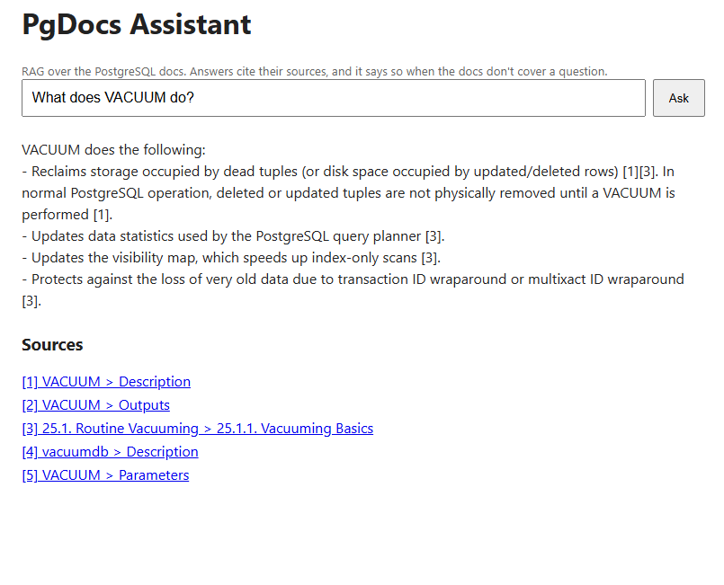
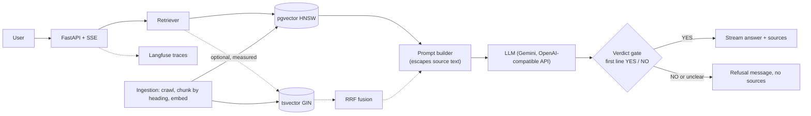

# PgDocs Assistant


A retrieval-augmented assistant that answers questions about the PostgreSQL 16 documentation, streams the answer, cites its sources, and says so when the docs don't cover the question.

Everything lives in one PostgreSQL instance: vectors (pgvector), full-text search (`tsvector`) and metadata filters. The repo also contains the evaluation set and scripts used to measure every design choice, including the ones that turned out not to help.

**Live demo:** TODO (deployment pending)



## What it does

- Streams answers over Server-Sent Events, with numbered citations (`[1]`, `[2]`) that map to the retrieved sections.
- Refuses questions the documentation does not cover instead of guessing. The refusal decision is made by the model and enforced in code: sources are shown only for answers, and an unreadable verdict is treated as a refusal.
- Traces every request (retrieval, LLM call, verdict) in Langfuse.
- Runs lint, tests and a Docker smoke test in CI on every push.

## Architecture



Solid lines are the default chat path. Dashed lines (keyword search, fusion, cross-encoder reranker) are implemented and evaluated, but are not in the default path, because the measurements below showed no gain.

## Results

All numbers come from the scripts in `eval/` and the committed files in `eval/results/`. Embeddings: `BAAI/bge-small-en-v1.5`. LLM: `gemini-3.5-flash-lite` (free tier), evaluated November 2026. Free-tier model IDs get retired, so re-run before trusting these numbers on a different model.

### Evaluation set

48 hand-written questions over the PostgreSQL 16 docs (1,134 pages, 6,972 chunks): 25 factual, 10 that need more than one page, and 13 unanswerable (8 of them about PostgreSQL-adjacent tools the docs do not cover, such as PgBouncer or PostGIS). Each answerable question lists the doc page or pages that answer it.

### Retrieval (35 answerable questions)

`hit@5`: any expected page is in the top 5. `MRR`: reciprocal rank of the first expected page. `multi@5`: share of expected pages found in the top 5, for the 10 multi-page questions. Latency is retrieval only (embedding, search, optional rerank), measured after warm-up on a laptop.

| Config | hit@5 | MRR | multi@5 | p50 | p95 |
|---|---|---|---|---|---|
| Vector only | 0.829 | 0.665 | 0.517 | 12 ms | 129 ms |
| Keyword only (`ts_rank_cd`) | 0.429 | 0.281 | 0.250 | 43 ms | 128 ms |
| Hybrid (RRF) | 0.829 | 0.609 | 0.517 | 96 ms | 221 ms |
| Hybrid, vector weight 2x | 0.829 | 0.607 | 0.467 | 66 ms | 152 ms |
| Hybrid, vector weight 3x | 0.857 | 0.597 | 0.467 | 62 ms | 165 ms |
| Vector + rerank (30 candidates) | 0.771 | 0.647 | 0.383 | 3,231 ms | 3,869 ms |
| Vector + rerank (10 candidates) | 0.771 | 0.667 | 0.417 | 1,253 ms | 1,474 ms |
| Vector + rerank (5 candidates) | 0.829 | 0.650 | 0.517 | 847 ms | 1,090 ms |
| Hybrid + rerank (30 candidates) | 0.771 | 0.650 | 0.483 | 3,433 ms | 4,011 ms |

With 35 questions, one question is worth about 2.9 points of hit@5, so differences of one or two questions are noise.

### Answer guardrail (one run, 48 questions)

| | Result |
|---|---|
| Unanswerable questions refused | 13 of 13 |
| Answerable questions answered | 25 of 35 |
| Answerable questions refused | 10 of 35 |

The guard refuses more than it needs to. 5 of the 10 refusals are questions where the right page was not retrieved, so refusing was defensible. For the other 5 (f10, f25, m03, m06, m07) I have not yet classified whether the model was too strict.

### Answer faithfulness (Ragas)

Mean faithfulness **0.93** on a sample of 15 answerable questions: 12 answered and scored, 3 refused, 0 errors. The lowest score was 0.5 on a one-sentence answer, which suggests one of its two claims was not supported by the sources. The judge is the same model family that wrote the answers, which can bias scores upward, and 12 scored answers is a small sample.

### Prompt-injection smoke test

Four planted-source attacks, each run once at temperature 0, all passed: instruction override, forged `ANSWERABLE: YES`, delimiter break-out, and system-prompt leak. This is a smoke test, not proof of robustness.

### Resource use

Idle, on Docker Desktop: the API container uses about 290 MiB and Postgres about 100 MiB.

TODO: add time-to-first-token and end-to-end latency from the Langfuse traces.

## What I learned

1. **Hybrid search did not beat vector search on this set.** hit@5 tied at 0.829 and MRR was lower (0.609 vs 0.665). Keyword-only was far worse (0.429). Weighting vector search more helped by at most one question, with lower MRR, which I treat as noise. The two methods miss different questions, so they are complementary, but equal-weight rank fusion did not exploit that. PostgreSQL `ts_rank_cd` has no inverse document frequency, so common words in natural-language questions add noise. It is BM25-like, not BM25.
2. **The cross-encoder reranker did not pay for itself.** It never improved hit@5, and added roughly 0.85 to 3.4 seconds of median latency depending on how many candidates it scored. Reranking only 5 candidates cannot change hit@5 by construction. So the default chat path uses plain vector search.
3. **A score threshold could not decide "no evidence".** No cutoff on cosine, keyword, fusion or reranker scores separated answerable from unanswerable questions. The best reranker cutoff still answered 4 of 13 unanswerable questions and refused 3 answerable ones, because a reranker measures topical similarity, and PostgreSQL-adjacent questions look topically similar to real pages. A first-line model verdict (`ANSWERABLE: YES/NO`), enforced in code, refused all 13 on this set.
4. **Most retrieval misses were vocabulary gaps.** "How do I make several statements succeed or fail together?" never reaches the transaction tutorial, because the page says "transaction", `BEGIN` and `COMMIT`. A stronger embedding model or query rewriting would be the next experiment.

## Design decisions

- **One database for everything.** pgvector, full-text search and metadata filters in PostgreSQL mean one system to run and back up, and filters run inside SQL before ranking.
- **Heading-aware chunking.** Each chunk keeps its section path (for example `VACUUM > Description`), which is used in citations, in embeddings and for keyword weighting. Reference pages take their name from the page title.
- **Provider-agnostic LLM layer.** `app/generation/llm.py` is a single function. Gemini, Groq, OpenRouter and Ollama use the same OpenAI-compatible client, and Anthropic is supported separately.
- **Fail closed.** If the model's first line is not a clear `ANSWERABLE: YES`, the user gets the refusal message and no sources.
- **Prompt-injection defences.** Retrieved text is wrapped in `<source>` tags with the closing and opening tags escaped, the prompt declares sources untrusted, and the verdict gate stops forged answers.
- **Tracing never breaks a request.** Langfuse calls are wrapped so a tracing failure is logged and ignored.

## Run it

Requirements: Docker Desktop, Python 3.13, and a free Gemini API key.

```bash
git clone https://github.com/varadendrasimha511/pgdocs-assistant.git
cd pgdocs-assistant
cp .env.example .env          # Windows: copy .env.example .env, then add your keys
docker compose up -d db

python -m venv .venv && source .venv/bin/activate   # Windows: .venv\Scripts\activate
pip install -r requirements.txt
python -m app.ingest.run --version 16               # about an hour: crawls, chunks and embeds ~1,100 pages

docker compose up --build -d                        # API on http://localhost:8000
```

Ingestion caches pages in `data/raw/` and is safe to re-run.

### Configuration (`.env`)

| Variable | Purpose |
|---|---|
| `DATABASE_URL` | Postgres connection string (`127.0.0.1:5433` from your machine, `db:5432` inside Docker) |
| `LLM_PROVIDER`, `LLM_API_KEY`, `LLM_MODEL` | Which LLM to call (`gemini`, `groq`, `openrouter`, `ollama`, `anthropic`) |
| `EMBED_MODEL` | Embedding model (384 dimensions; changing it needs a re-ingest and a schema change) |
| `RERANK_ENABLED`, `RERANK_MODEL` | Optional cross-encoder reranker (off in the chat path) |
| `LANGFUSE_PUBLIC_KEY`, `LANGFUSE_SECRET_KEY`, `LANGFUSE_BASE_URL` | Optional tracing; the app runs without them |

### Reproduce the evaluation

```bash
python -m eval.validate_dataset     # checks every expected URL exists in your database
python -m eval.run_eval             # retrieval table, nine configurations
python -m eval.threshold_report     # why score cutoffs fail
python -m eval.guardrail_eval       # verdict gate on all 48 questions (calls the LLM)
python -m eval.injection_eval       # four prompt-injection cases (calls the LLM)
pip install -r requirements-eval.txt
python -m eval.faithfulness_eval    # Ragas faithfulness on a 15-question sample
```

The LLM-based scripts pause between calls to stay inside free-tier rate limits.

## Repository layout

```
app/
  main.py            FastAPI app, /ask (SSE) and /search
  config.py          settings from environment
  db.py, schema.sql  connection pool and schema (table, HNSW and GIN indexes)
  embeddings.py      local embedding model
  observability.py   Langfuse tracing helper
  ingest/            crawler, heading-aware chunker, ingestion runner
  retrieval/         vector and keyword search, RRF, reranker, filters
  generation/        prompts, LLM client, verdict gate
eval/                dataset, evaluation scripts, committed results
tests/               unit tests (chunker, RRF, filters, guard, prompt, tracing)
.github/workflows/   CI: lint, tests, Docker build and smoke test
```

## Limitations

- **Small evaluation set.** 35 answerable questions, so small differences are noise. The questions and expected pages were written by hand, and some questions (for example m04 and m10) may have valid answers on pages that are not listed, which would understate recall.
- **The guard is conservative.** It refused 10 of 35 answerable questions in the one run I measured, and I have not tuned the prompt, to avoid fitting it to the evaluation set.
- **One run, one model.** Results come from a single run of a free-tier model. Faithfulness uses the same model family as judge and generator.
- **Vocabulary mismatch.** Questions that do not use the documentation's terms can miss the right page.
- **One docs version and language.** PostgreSQL 16 and English only. There is no per-user authentication.
- **Injection coverage is narrow.** Four attack patterns were tested.
- **Citations are chunk-level.** Several of the five sources can come from the same page. Citation numbers are not yet validated in code against the retrieved sources.

## License

TODO: add a license file. The PostgreSQL documentation is available under the PostgreSQL License.
